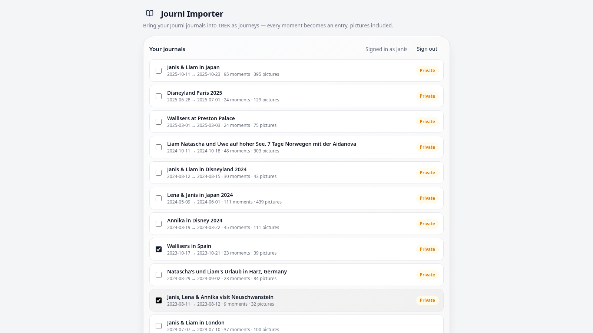

# Journi Importer

Import your [Journi](https://www.journiapp.com) journals into TREK as journeys. Sign in, tick the journals you want, and every moment becomes a journal entry with its date, story, position and pictures.



## What it does

Journi has no export. What it does have is the web app's own API, and this plugin uses exactly that, from your TREK server:

- **Sign in to Journi** on the plugin page. The plugin lists every journal of your account, private ones included, with dates, moment and picture counts.
- **Or paste a journal link.** A journal that is public in Journi can be added without signing in.
- **Pick journals, click Import.** Each journal becomes one TREK journey (title plus date range). Each moment becomes an entry with its title, story, local date in the zone it was written in, and its position. Flights become "Flight FRA → NRT" entries; stamps, stickers and weather cards are skipped.
- **Pictures come along.** With the option ticked, every picture of every moment is fetched from Journi by the server and attached to its entry, one at a time, so a long journal just takes a few minutes.
- **Undo.** One click removes the journeys the import created, with all their entries and pictures.

Nothing else: no trips, places, days, bookings or costs. If you want a Journi journal turned into a full trip plan, that is what [trip-importer](https://github.com/raduwolf12/trip-importer) is for. This plugin is a fork of its Journi path, reduced to journeys only.

## Screenshots


## Permissions

| Permission | Why |
|---|---|
| `db:write:journal` | Creates the journey, its entries and the pictures attached to them; deletes them again when you undo an import. |
| `http:outbound` | The server talks to Journi: the login, the journal fetch and every picture. |
| `http:outbound:www.journiapp.com` | The only host it is allowed to reach. Journi's web API and pictures both live there. |

The plugin requires the **journey** addon, because that is where the imported journals go.

### What happens with your Journi password

The password travels once from the plugin page to your TREK server, which sends it to Journi's login endpoint over HTTPS and keeps only the session cookie Journi answers with. That cookie lives in the plugin process memory, bound to your TREK user, for one hour or until you sign out. It is never written to the database or to disk, and the plugin page keeps nothing but an opaque handle to it. If you prefer, you can change your Journi password after the import.

## Setup

1. Install the plugin from the TREK plugin store, or upload the `plugin.zip` of a release under Admin → Plugins.
2. Activate it and accept the permissions above, including outbound access to `www.journiapp.com`.
3. Open **Journi Importer** from the navigation, sign in with your Journi email and password, tick journals, click **Import selected**.

## Notes

- A journal's moments are created about ten per second; pictures about four per second. A journal with 400 pictures takes roughly two minutes.
- Moments without a position get the median position of their located pictures, if any.
- Journi strips location names, so an entry's location name is its title.
- Importing the same journal twice creates a second journey. Use **Undo** right after an import, or delete the journey in TREK.

## Development

```bash
npm install
npx trek-plugin-sdk dev      # http://localhost:4317, the UI under /preview
npx trek-plugin-sdk pack     # plugin.zip for sideloading
JOURNI_EMAIL=… JOURNI_PASSWORD=… npm run test:e2e
```

The end-to-end test starts the dev host, signs in to Journi with the account in the environment, imports the smallest journal that has pictures, attaches a few of them, and undoes everything again. Without the two variables it is skipped. The same test runs in GitHub Actions on every push and pull request, and every Monday morning, so a change on Journi's side shows up as a red run; the repository secrets `JOURNI_EMAIL` and `JOURNI_PASSWORD` feed it.

Releases are signed and cut by the **release** workflow, see [RELEASING.md](./RELEASING.md).

## License

MIT. Forked from the Journi import of [raduwolf12/trip-importer](https://github.com/raduwolf12/trip-importer) (MIT).
